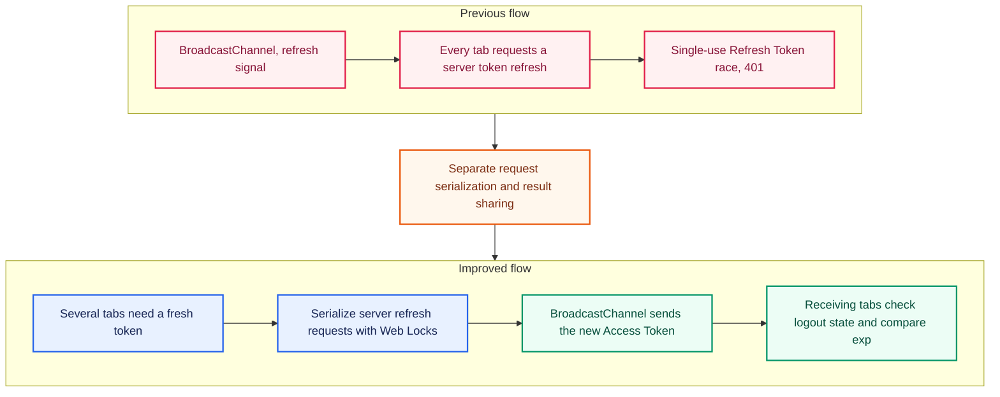

<!-- architecture -->

<!-- /architecture -->

<!-- case: liveTranscript -->

## Live transcripts and reconnection across call states

### Overview

Agents needed to read live transcripts and retain the conversation when the screen’s streaming connection was interrupted and restored.

**A lifecycle for call detection and transcript delivery** I connected current-call detection, live transcription, and waiting for the next call. Confirmed text stays visible during reconnection; transcript state resets only when the call changes.

### Implementation

**Switching between waiting polls and live SSE** While waiting, the interface polls for the current call every second and switches to SSE when a call starts. Call end, fatal errors, or exhausted retries resume polling so the next call can be detected.

**Separating partial and confirmed speech** Each speaker’s partial text is replaced with its latest version. Confirmed utterances are deduplicated by ID and ordered by time. Reconnection preserves the current call’s text until a server snapshot reconciles state.

**Reconnection based on error type** I distinguished authentication renewal, invalid permission or call state, and network interruption. A missing heartbeat triggers bounded retries, while switching browser tabs keeps the connection open.

### Outcomes

**Recovery without clearing confirmed speech** Confirmed text remains readable during reconnection and is reconciled with server state afterward. Tests cover snapshots, duplicate utterances, ordering, and error-specific retry behavior.

<!-- case: consultationReview -->

## Connecting transcript search, recordings, and AI analysis

### Overview

Reviewing a consultation required finding the underlying utterances, listening to the recording, and checking both the original AI output and saved analysis.

**Aligning speech, playback, and analysis state** I synchronized transcript and recording navigation without letting automatic live following interrupt search or playback. Analysis also needed to distinguish the initial streamed output from saved final values.

### Implementation

**Linking utterances to recording timestamps** The interface highlights the utterance matching playback time, and selecting a sentence seeks the recording to that point. Exploring earlier speech stops automatic following; ResizeObserver detects changes in transcript height.

**Immediate AI output followed by saved values** I displayed classification and summary events received over SSE immediately, then fetched saved analysis when processing ended. Failed refreshes preserve the existing result and use bounded retries.

### Outcomes

**Reviewing evidence and analysis together** Transcript search, sentence-level recording navigation, and original and confirmed analysis form one consultation-review flow. Tests cover playback synchronization, stopping automatic following, and retrying failed confirmed-value requests.

<!-- case: multiTabAuth -->

## Synchronizing multi-tab authentication and idle logout

### Overview

I kept activity and authentication state consistent across consultation tabs and prevented refresh failures from propagating into logout in other tabs.

**Idle logout that respects call state** Independent activity timers could log out one tab while an agent was working in another or leave a closed session visible. The implementation needed to use the server-provided inactivity limit and pause the timer during active calls.

**Concurrent use of single-use refresh tokens** When several tabs received 401 responses together, each tried to refresh with the same single-use Refresh Token. After one tab consumed it, the others retried with an already-used token, received 401 responses, and could propagate logout to otherwise valid tabs.

### Implementation

**Synchronizing activity and propagating logout** react-idle-timer coordinates activity and timers using crossTab, leaderElection, and syncTimers. The leader handles the server request for inactivity logout. Tabs receiving logged-out on a separate authentication BroadcastChannel clear tokens and query caches, then navigate to the login page.

**Serializing refresh requests and sharing results** Web Lock prevents concurrent server refresh requests, while an authentication BroadcastChannel shares the new Access Token. Receiving tabs apply it without making another refresh request.

**Rejecting older tokens and late refresh results during logout** Receiving tabs check logout state and the token’s exp value and apply only a newer Access Token. Starting logout blocks refreshes and late result application; Refresh Tokens are never sent through the channel.

### Outcomes

**Verifying token application and error separation** Tests verify that receiving tabs adopt a new Access Token without a server request and ignore missing payloads, tokens received during logout, and older expirations. Network and 5xx failures are also separated from invalid authentication so temporary outages do not expand into cross-tab logout.
