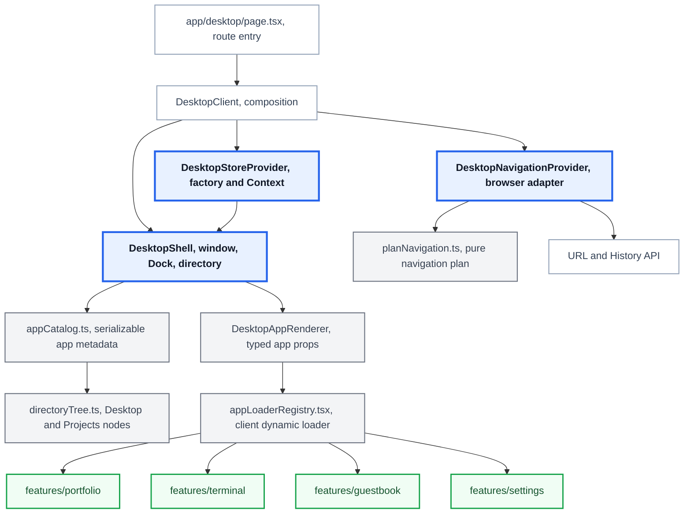

<!-- architecture -->

<!-- /architecture -->

<!-- case: ownership -->

## Separating Desktop responsibilities from app features

### Overview

I separated window and browser navigation from app behavior and used adapters to pass only the state and actions each app needs.

**Dependencies between the runtime and app features** Terminal, Guestbook, and Settings run inside a Desktop that manages windows and the Dock. Direct feature imports of the Desktop store would couple internal app changes to the runtime, so the design needed an explicit dependency boundary.

### Implementation

**Injecting state and actions through adapters** I placed DesktopShell, windows, the Dock, directories, navigation, and the store in src/app/desktop, and kept each application screen and user flow in src/features. For Terminal, Guestbook, and Settings, adapters inject Desktop state as props so features do not import the Desktop store directly.

### Outcomes

**Removing direct Desktop-store dependencies** Terminal, Guestbook, and Settings receive the state and actions they need through adapter props. Features do not import the Desktop store directly, preserving the dependency boundary between the runtime and app behavior.

<!-- case: appContract -->

## Defining app registration and URL navigation contracts

### Overview

I connected Dock entries, loaders, folders, and shared URLs through app IDs and used types and structural checks to detect missing registrations.

**App registration spanning multiple files** App execution depends on metadata, dynamic loaders, folder nodes, and URL handling. Missing registrations could leave execution and shared URLs inconsistent, so those relationships needed checks in code and tests.

### Implementation

**Separating metadata, loading, and navigation** appCatalog.ts holds only serializable metadata that the server can read, while appLoaderRegistry.tsx holds client-only dynamic imports. directoryTree.ts references catalog app IDs. planNavigation.ts calculates state changes and URL effects as a pure function, and DesktopNavigationProvider is the only caller of the History API.

### Outcomes

**Checking registration consistency and navigation behavior** I separated static app metadata, client-only loaders, folder nodes, and browser navigation into files with distinct responsibilities. Types check the relationship between app IDs and props, while structure checks and unit tests verify consistency across the app catalog, loaders, URLs, folder nodes, and localized title keys.

Tests also check that shared URL normalization, user navigation, and back navigation follow the same navigation plan. They cover how popstate events from browser history changes update the Desktop state.
