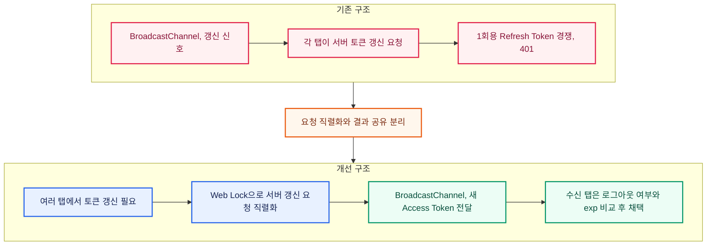

<!-- architecture -->

<!-- /architecture -->

<!-- case: liveTranscript -->

## 통화 상태에 따른 실시간 전사와 연결 복구

### 개요

상담사는 통화 중 생성되는 전사를 읽고, 화면의 실시간 연결이 끊겼다가 복구돼도 이전 대화를 계속 확인할 수 있어야 했습니다.

**통화 감지와 전사 수신의 생명주기** 현재 통화 감지, 실시간 전사와 종료 후 다음 통화 대기를 한 흐름으로 구현했습니다. 연결 복구 중에는 기존 확정 전사를 유지하고, 통화가 바뀔 때만 전사 상태를 초기화하도록 했습니다.

### 세부 내용

**대기 폴링과 통화 중 SSE 전환** 대기 중에는 현재 통화를 1초 간격으로 조회하고 통화가 시작되면 SSE 수신으로 전환했습니다. 통화 종료, 치명 오류나 재시도 소진 시에는 조회를 재개해 다음 통화를 감지하도록 구성했습니다.

**임시 전사와 확정 전사 분리** 화자별 임시 전사는 최신 내용으로 교체하고, 확정 전사는 발화 ID로 중복을 제거해 시간순으로 정렬했습니다. 같은 통화의 재연결에서는 기존 전사를 보존한 채 서버 스냅샷으로 상태를 맞췄습니다.

**오류 종류에 따른 재연결 처리** 인증 갱신이 필요한 오류, 권한이나 통화가 유효하지 않은 오류, 네트워크 중단을 구분했습니다. heartbeat 중단을 감지해 제한된 재시도를 수행하고, 탭 전환 중에는 연결을 유지하도록 구성했습니다.

### 성과

**전사를 유지하는 복구와 다음 통화 감지** 재연결 중 읽던 확정 전사가 사라지지 않고, 복구 후 서버 상태로 다시 맞춰지는 흐름을 구현했습니다. 스냅샷, 중복 발화, 시간순 정렬과 오류별 재시도 동작을 테스트로 검증했습니다.

<!-- case: consultationReview -->

## 전사 검색, 녹취 재생과 AI 분석 검토 연결

### 개요

상담 이력을 검토할 때는 요약만 읽는 것이 아니라 근거가 된 발화를 찾고 녹취를 들으며, AI 원본과 저장된 분석 결과를 확인할 수 있어야 했습니다.

**발화, 재생 시점과 분석 상태의 연결** 전사와 녹취의 탐색 위치를 맞추고, 새 전사 자동 추적이 사용자의 검색이나 재생 탐색을 방해하지 않도록 구현했습니다. 분석 결과도 수신 직후 값과 저장된 확정값을 구분해야 했습니다.

### 세부 내용

**전사 문장과 녹취 시점 연결** 재생 시각에 해당하는 발화를 표시하고, 전사 문장을 누르면 녹취를 해당 시점으로 이동하도록 연결했습니다. 사용자가 과거 문장을 탐색하면 자동 추적을 멈추고, 새 전사 높이는 ResizeObserver로 감지하도록 구성했습니다.

**AI 원본 즉시 표시와 확정값 반영** SSE로 받은 AI 분류와 요약을 먼저 표시하고, 분석이 끝나면 상세 API에서 저장된 확정값을 조회했습니다. 재조회가 실패해도 이미 받은 결과를 유지한 채 제한된 재시도를 하도록 처리했습니다.

### 성과

**근거 발화부터 분석 결과까지 검토** 전사 검색과 문장별 녹취 이동, AI 원본과 확정 결과 확인을 같은 상담 이력 흐름으로 구성했습니다. 재생 시점 동기화와 자동 추적 중단, 확정값 조회 실패 후 재시도 동작을 테스트로 확인했습니다.

<!-- case: multiTabAuth -->

## 멀티탭 인증과 비활성 로그아웃 동기화

### 개요

여러 탭에서 상담을 이어갈 때 활동 시간과 인증 상태를 일관되게 유지하고, 토큰 갱신 실패가 다른 탭의 로그아웃으로 확대되지 않도록 구성했습니다.

**통화 상태를 반영한 비활성 로그아웃** 탭마다 활동 시간을 따로 계산하면 한 탭에서 상담 중인데 다른 탭이 로그아웃하거나 종료된 세션의 화면이 남을 수 있었습니다. 서버가 내려주는 비활성 제한 시간을 사용하고, 실제 통화 중에는 타이머를 일시정지해야 했습니다.

**1회용 Refresh Token의 동시 사용** 여러 탭이 동시에 401을 받으면 각 탭이 1회용 Refresh Token으로 갱신을 시도했습니다. 한 탭이 토큰을 먼저 사용하면 나머지 탭은 이미 소비된 토큰으로 다시 요청해 401을 받았고, 이 실패가 다른 탭의 로그아웃으로 확대될 수 있었습니다.

### 세부 내용

**활동 시간 동기화와 로그아웃 전파** react-idle-timer의 crossTab, leaderElection, syncTimers 설정으로 탭 간 활동과 타이머를 동기화했습니다. 비활성 로그아웃의 서버 요청은 리더 탭이 담당하고, 별도 인증 BroadcastChannel의 logged-out 메시지를 받은 탭은 토큰과 조회 캐시를 지운 뒤 로그인 페이지로 이동합니다.

**갱신 요청 직렬화와 결과 공유** 서버 갱신 요청의 동시 실행은 Web Lock으로 막고, 갱신된 Access Token은 인증 BroadcastChannel로 공유했습니다. 토큰을 받은 탭은 별도 갱신 요청 없이 적용하도록 구성했습니다.

**로그아웃 중 늦은 응답과 오래된 토큰 차단** 수신 탭은 로그아웃 진행 여부와 토큰의 exp 값을 비교해 더 새로운 Access Token만 적용합니다. 로그아웃 시작 후에는 갱신과 결과 적용을 차단하고, Refresh Token은 채널로 전달하지 않도록 했습니다.

### 성과

**탭 간 토큰 적용과 오류 분리 검증** 수신 탭이 서버 요청 없이 새 Access Token을 적용하고, 메시지 값 누락, 로그아웃 진행 중, 만료 시각이 더 오래된 토큰은 무시하는 시나리오를 테스트했습니다. 네트워크와 5xx 오류도 인증 무효와 분리해 일시 장애가 전체 로그아웃으로 확대되지 않게 했습니다.
