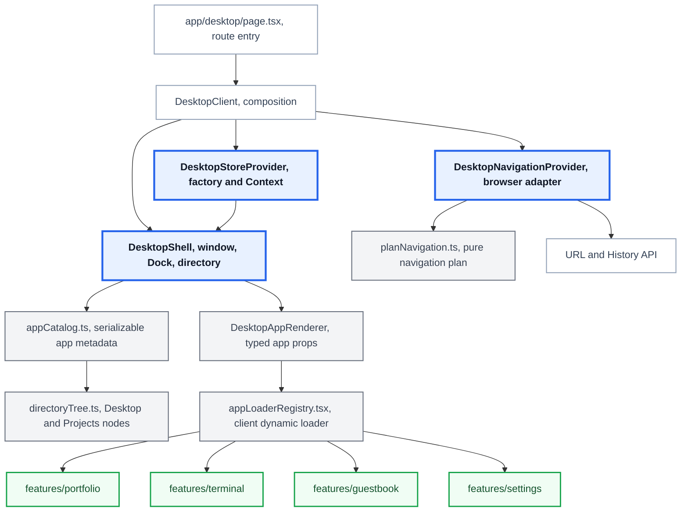

<!-- architecture -->

<!-- /architecture -->

<!-- case: ownership -->

## Desktop과 앱 기능의 책임 분리

### 개요

창과 브라우저 탐색을 담당하는 Desktop과 각 앱의 제품 기능을 분리하고, 필요한 상태만 Adapter를 통해 전달하도록 설계했습니다.

**실행 환경과 앱 기능의 의존성** 창과 Dock을 관리하는 Desktop 안에 Terminal, Guestbook, Settings 등의 앱이 함께 동작합니다. 각 feature가 Desktop store를 직접 참조하면 앱 내부 변경과 실행 환경의 변경이 서로 얽히므로 의존성 경계가 필요했습니다.

### 세부 내용

**Adapter를 통한 상태와 동작 주입** src/app/desktop에는 DesktopShell, 창, Dock, directory, navigation, store를 두고 src/features에는 앱별 화면과 사용자 흐름을 뒀습니다. Terminal, Guestbook, Settings처럼 Desktop 상태가 필요한 앱은 Adapter가 값을 props로 주입해 feature가 Desktop store를 직접 import하지 않게 했습니다.

### 성과

**Desktop store 직접 참조 분리** Terminal, Guestbook, Settings는 Adapter에서 필요한 상태와 동작을 props로 전달받습니다. feature가 Desktop store를 직접 import하지 않는 구성으로 실행 환경과 앱 기능의 의존성 경계를 유지했습니다.

<!-- case: appContract -->

## 앱 등록과 URL 탐색 계약 정립

### 개요

새 앱을 추가할 때 Dock, 로더, 폴더와 공유 URL이 같은 앱을 가리키도록 앱 ID를 기준으로 연결하고, 누락을 타입과 구조 검사로 확인했습니다.

**여러 파일에 걸친 앱 등록 정보** 앱 실행에는 메타데이터, 동적 로더, 폴더 노드와 URL 처리가 함께 필요합니다. 한 곳의 등록이 누락되면 실행과 공유 URL이 어긋날 수 있어 이 관계를 코드와 테스트로 확인해야 했습니다.

### 세부 내용

**메타데이터, 로더와 탐색의 역할 분리** appCatalog.ts에는 서버에서도 읽을 수 있는 앱 메타데이터만, appLoaderRegistry.tsx에는 client 전용 dynamic import만 뒀습니다. directoryTree.ts는 catalog의 앱 ID를 참조하고, planNavigation.ts는 상태 변경과 URL 효과를 순수 함수로 계산한 뒤 DesktopNavigationProvider만 History API를 호출하게 했습니다.

### 성과

**앱 등록 정합성과 탐색 동작 검증** 앱의 정적 정보, 클라이언트 전용 로더, 폴더 노드와 브라우저 탐색 처리를 역할별 파일로 분리했습니다. 앱 ID와 props의 관계는 타입으로 확인하고, 앱 목록과 로더, URL, 폴더 노드와 다국어 제목 키의 정합성은 구조 검사와 단위 테스트로 확인합니다.

공유 URL 정규화, 사용자 탐색과 뒤로 가기가 같은 탐색 계획을 따르는지도 테스트합니다. 브라우저 이력이 바뀔 때 발생하는 popstate 이벤트가 Desktop 상태에 반영되는 과정도 검증 대상에 포함합니다.
